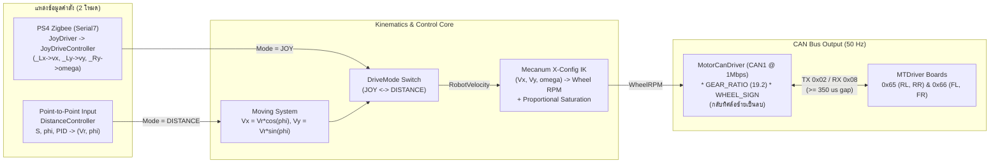

# Lowlevel-Auto — Teensy 4.1 Mecanum Drive Controller

เฟิร์มแวร์ Low-level บน **Teensy 4.1** (PlatformIO / Arduino Framework) สำหรับควบคุมหุ่นยนต์ขับเคลื่อน **Mecanum 4 ล้อ (X-configuration)** โดยรองรับทั้งการบังคับด้วยจอยไร้สาย (PS4 Zigbee) และการเคลื่อนที่อัตโนมัติแบบ Point-to-Point

---

## 1. เป้าหมายการจัดทำโค้ด (Project Goals)

1. **แยกสถาปัตยกรรม Low-level ให้เป็นโมดูลที่ดูแลและทดสอบง่าย**
   - แยกส่วนคณิตศาสตร์/การควบคุม (`Kinematics`, `DistanceController`, `JoyDriveController`, `PIDController`) ไว้ใน `include/` และ `src/`
   - แยกส่วนสื่อสารฮาร์ดแวร์และโปรโตคอล (`JoyDriver`, `MotorCanDriver`, `SerialProxy`) ออกเป็น Private Libraries ใน `lib/` เพื่อให้แต่ละโมดูลไม่ผูกติดกันและนำไปใช้ซ้ำได้
2. **สั่งงานมอเตอร์ผ่าน CAN Bus โดยไม่ต้องอ่าน Encoder เข้า Teensy**
   - งาน Closed-loop speed control ของแต่ละล้อทำอยู่บนบอร์ดขับ **MTDriver** (`0x65` ล้อหลัง และ `0x66` ล้อหน้า) พร้อมตัวเข้ารหัสของตัวขับเอง
   - Teensy 4.1 ทำหน้าที่คำนวณความเร็วล้อ (RPM) แล้วส่งคำสั่งความเร็วผ่าน `CAN1` (`1 Mbps`) รวมถึงเช็กสถานะการเชื่อมต่อกลับจากเฟรม `0x08`
3. **รองรับการพัฒนาต่อสู่ระบบอัตโนมัติ (Autonomous Point-to-Point)**
   - แยกชั้นรับตำแหน่งและเป้าหมาย (`pose` / `goal`) ออกจาก Loop ควบคุมหลัก เพื่อให้สลับจากการจำลองทดสอบบนโต๊ะไปรับค่าตำแหน่ง `(x, y, yaw)` และเป้าหมายจาก **High-level** ผ่าน `SerialProxy` (`packets.h`) ได้ทันที

---

## 2. หลักการทำงานโดยคร่าวๆ (System Architecture & Workflow)

### ภาพรวมการไหลของข้อมูล (Data Flow @ 100 Hz)



### สรุปหน้าที่ของแต่ละโมดูล

| โฟลเดอร์ / ไฟล์ | หน้าที่หลัก |
| :--- | :--- |
| [include/config.h](include/config.h) | ศูนย์รวมค่าคงที่: timing, เรขาคณิตหุ่น, `GEAR_RATIO`, `WHEEL_SIGN`, PID gains, CAN IDs และแกนจอย |
| `include/kinematics.h`, `src/kinematics.cpp` | แปลง $(V_r, \varphi, \omega) \to (V_x, V_y, \omega)$ และ Inverse Kinematics สำหรับ Mecanum X-config พร้อม Proportional Saturation (รักษาทิศทางเมื่อชนเพดาน `MAX_WHEEL_RPM`) |
| `include/distance_control.h`, `src/distance_control.cpp` | คำนวณระยะเหลือ $S$, มุมโลก $\alpha$, ทิศเคลื่อนที่เทียบตัวหุ่น $\varphi = \text{wrap}(\alpha - \psi)$ และคุมความเร็ว $V_r$ ด้วย Distance PID + Slew-rate limiter |
| `include/joy_drive.h`, `src/joy_drive.cpp` | แปลงค่าแกนจอย `_Lx`, `_Ly`, `_Ry` เป็น `(vx, vy, omega)` พร้อม Slew-rate limiter และตัดเป็น `0` ทันทีเมื่อสัญญาณ Zigbee ขาด |
| `lib/JoyDriver/` | รับแพ็กเกต `#s` (12 bytes) จากจอย PS4 ผ่าน `Serial7` (`115200` baud) และตรวจ Link timeout (`JOY_TIMEOUT_MS`) |
| `lib/MotorCanDriver/` | สื่อสาร `FlexCAN_T4` (`CAN1`) กับ MTDriver `0x65` / `0x66` — คูณ `GEAR_RATIO` (`19.2f`) และกลับทิศล้อซ้าย (`FL, RL * -1`) ก่อนส่งเฟรม `0x02` รวมถึงเช็กสถานะบอร์ดจากเฟรม `0x08` |
| `lib/SerialProxy/` | โปรโตคอล Binary Packet (`#` + `id` + payload + `checksum` + `\n`) พร้อมโครงสร้าง `LidarPacket ('L')`, `StereoCameraPacket ('C')`, `WebcamPacket ('W')`, `McuStagePacket ('S')`, และ `GoalPacket ('G')` |
| `src/main.cpp` | Loop ควบคุม `100 Hz` (ส่ง CAN `50 Hz`, พิมพ์ Debug `500 ms`) และจัดการสลับโหมด `JOY <-> DISTANCE` |

### กลไกความปลอดภัยและการใช้งานเบื้องต้น
- **Fail-safe**: ในโหมด `JOY` หากขาดการติดต่อจาก Zigbee เกิน `400 ms` ระบบสั่ง `(vx, vy, omega) = (0, 0, 0)` ทันที และในโหมด `DISTANCE` จะเริ่มต้นด้วย `motionEnabled = false` (`0 RPM`) เสมอจนกว่าจะได้รับเป้าหมาย
- **การสลับโหมด**: ค่าเริ่มต้นคือโหมด `JOY` สามารถสลับกับโหมด `DISTANCE` ได้ผ่าน Serial Monitor (`mode joy` / `mode dist`) หรือกดปุ่ม `option` บนจอย (และกด `cross` เพื่อหยุดในโหมด `DISTANCE`)
- **คำสั่งทดสอบใน Serial Monitor (`115200` baud)**:
  - `mode joy` / `mode dist` — สลับโหมดควบคุม
  - `g <x> <y>` — ตั้งเป้าหมาย `(x, y)` (เมตร) และเริ่มเคลื่อนที่ในโหมด `DISTANCE`
  - `p <x> <y> <yaw>` — กำหนดตำแหน่งและมุมหัวหุ่นจำลอง (`m, m, deg`)
  - `sim <0|1>` — เปิด/ปิดการอินทิเกรต $(V_x, V_y)$ จำลองการเคลื่อนที่
  - `0` หรือ `stop` — หยุดมอเตอร์ทั้งหมดทันที (`0 RPM`)

---

## 3. แผนการพัฒนาในอนาคต (Future Roadmap)

### สถานะปัจจุบัน (Completed)
- [x] Mecanum X-configuration Inverse Kinematics + Proportional Desaturation
- [x] Distance Control (`S`, `phi`, Distance PID, Goal tolerance deadband, Slew-rate limiter)
- [x] `MotorCanDriver` (`FlexCAN_T4` `CAN1`, `0x65`/`0x66`, `GEAR_RATIO = 19.2f`, กลับทิศล้อซ้าย `-1`, เช็ก CAN feedback `0x08`)
- [x] `JoyDriver` + `JoyDriveController` (`Serial7` PS4 Zigbee, Watchdog timeout, สลับโหมด `JOY <-> DISTANCE`)
- [x] นิยาม `packets.h` (`'C'`, `'L'`, `'W'`, `'S'`, `'G'`) และ `SerialProxy` ใน `lib/SerialProxy/`

### ขั้นตอนถัดไป (Next Phases)
1. **เชื่อมต่อ High-level Localization & Goal ผ่าน `SerialProxy`**
   - แทนที่ฟังก์ชัน `initPoseAndGoalSource()` และ `updatePoseAndGoal()` ใน `src/main.cpp` ให้รับ `(x, y, yaw_deg)` จาก `LidarPacket` / `StereoCameraPacket` / `WebcamPacket` (แปลง `degrees -> radians`) และรับเป้าหมายจาก `GoalPacket ('G')` พร้อม Watchdog ตัด `0 RPM` เมื่อ High-level ขาดการส่งข้อมูล
2. **เพิ่ม IMU (`BNO055`) สำหรับ Low-level Yaw Fusion**
   - เชื่อมต่อ BNO055 ผ่าน I2C ในโหมด `OPERATION_MODE_IMUPLUS` (ปิด Magnetometer เพื่อกันสัญญาณรบกวนจากมอเตอร์)
   - ใช้ `gyro_z` (rad/s) ทำ Prediction มุม $\hat{\psi}$ ที่ `100 Hz` ระหว่างรอบอัปเดต High-level และแก้ drift ด้วย Complementary Filter เมื่อได้รับ `yaw` ใหม่จาก High-level
3. **เพิ่ม Heading Control ($\omega$ Control)**
   - เพิ่ม Heading PID (ใช้ `gyro_z` เป็น Derivative damping ลด overshoot) เพื่อคำนวณ $\omega$ จากเป้าหมาย `GoalPacket.yaw` ส่งเข้า `MecanumKinematics::movingSystem(vr, phi, omega)` ให้หุ่นวิ่งและหมุนรักษามุมหัวหุ่นพร้อมกันได้ครบตาม `flow`
4. **วัดระยะตัวหุ่นจริงและจูนพารามิเตอร์บนพื้นสนาม**
   - วัดระยะจริง `HALF_LENGTH_X` (ครึ่งระยะเพลาหน้า–หลัง) และ `HALF_WIDTH_Y` (ครึ่งระยะหน้าล้อซ้าย–ขวา) เพื่อให้ค่า $\omega$ แม่นยำ
   - ปรับจูน `MAX_WHEEL_RPM`, PID gains (`DIST_KP/KI/KD` และ Heading PID) และ `YAW_COMPLEMENTARY_GAIN` บนพื้นใช้งานจริง

---

## 4. การ Build และอัปโหลด (PlatformIO)

```bash
# Build firmware สำหรับ Teensy 4.1
pio run -e teensy41

# Upload ลงบอร์ด Teensy 4.1
pio run -e teensy41 -t upload

# เปิด Serial Monitor (115200 baud)
pio device monitor -b 115200
```
