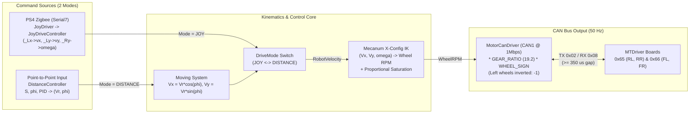

# Lowlevel-Auto — Teensy 4.1 Mecanum Drive Controller

Low-level firmware on **Teensy 4.1** (PlatformIO / Arduino Framework) for a **4-wheel Mecanum (X-configuration)** mobile robot, supporting both wireless PS4 Zigbee joystick driving and autonomous Point-to-Point navigation.

---

## 1. Project Goals

1. **Clean, Modular Firmware Architecture**
   - Separate core control and math logic (`Kinematics`, `DistanceController`, `JoyDriveController`, `PIDController`) in `include/` and `src/`.
   - Isolate hardware drivers and communication protocols (`JoyDriver`, `MotorCanDriver`, `SerialProxy`) as self-contained private libraries under `lib/` for reusability and easy maintenance.
2. **Closed-Loop Motor Actuation Over CAN Bus Without Teensy Encoder Wiring**
   - Individual motor closed-loop speed control runs directly on the **MTDriver** boards (`0x65` rear, `0x66` front) using their own encoders.
   - Teensy 4.1 computes wheel RPM targets, applies the gearbox ratio (`19.2f`) and motor polarity, transmits RPM commands over `CAN1` (`1 Mbps`), and monitors board connectivity via CAN feedback (`0x08`).
3. **Smooth Path to Full Autonomous Navigation**
   - Keep pose and goal ingestion decoupled in `src/main.cpp` so the stand-alone serial test input can be swapped seamlessly to High-level localization `(x, y, yaw)` and goal packets via `SerialProxy` (`packets.h`).

---

## 2. System Architecture & How It Works

### Data Flow Overview (`100 Hz` Control Loop)



### Module Summary

| Folder / File | Responsibility |
| :--- | :--- |
| [include/config.h](include/config.h) | Central configuration: loop timing, robot geometry, `GEAR_RATIO`, `WHEEL_SIGN`, PID gains, CAN IDs, and joystick settings |
| `include/kinematics.h`, `src/kinematics.cpp` | Converts $(V_r, \varphi, \omega) \to (V_x, V_y, \omega)$ and computes 4-wheel Mecanum X-config Inverse Kinematics with proportional saturation (preserves heading/direction when exceeding `MAX_WHEEL_RPM`) |
| `include/distance_control.h`, `src/distance_control.cpp` | Computes remaining distance $S$, world angle $\alpha$, robot-frame direction $\varphi = \text{wrap}(\alpha - \psi)$, and Distance PID output $V_r$ with slew-rate limiting |
| `include/joy_drive.h`, `src/joy_drive.cpp` | Maps joystick axes `_Lx`, `_Ly`, `_Ry` to `(vx, vy, omega)` with slew-rate limiting and immediate zeroing when the Zigbee link drops |
| `lib/JoyDriver/` | Parses 12-byte `#s` PS4 Zigbee packets on `Serial7` (`115200` baud) and provides link liveness watchdog (`JOY_TIMEOUT_MS`) |
| `lib/MotorCanDriver/` | Wraps `FlexCAN_T4` (`CAN1`) for MTDriver boards `0x65` and `0x66` — applies `GEAR_RATIO` (`19.2f`) and left-wheel inversion (`FL, RL * -1`) before sending `0x02` speed frames, and tracks board connection via `0x08` status frames |
| `lib/SerialProxy/` | Binary packet framing (`#` + `id` + payload + `checksum` + `\n`) with `LidarPacket ('L')`, `StereoCameraPacket ('C')`, `WebcamPacket ('W')`, `McuStagePacket ('S')`, and `GoalPacket ('G')` |
| `src/main.cpp` | Runs the `100 Hz` control loop (`50 Hz` CAN TX, `500 ms` debug output) and handles `JOY <-> DISTANCE` mode switching |

### Safety Mechanisms & Serial Commands
- **Fail-safe**: In `JOY` mode, losing the Zigbee signal for more than `400 ms` immediately zeroes `(vx, vy, omega)`. In `DISTANCE` mode, `motionEnabled` defaults to `false` (`0 RPM`) until a goal is explicitly commanded.
- **Mode Switching**: Boots into `JOY` mode by default and can switch between `JOY` and `DISTANCE` via Serial (`mode joy` / `mode dist`) or the controller `option` button (rising edge). Pressing `cross` stops motion in `DISTANCE` mode.
- **Serial Monitor Commands (`115200` baud)**:
  - `mode joy` / `mode dist` — Switch active control mode
  - `g <x> <y>` — Set target `(x, y)` in meters and enable motion (`DISTANCE` mode)
  - `p <x> <y> <yaw>` — Set simulated pose (`m, m, deg`)
  - `sim <0|1>` — Toggle simulated velocity integration for pose testing
  - `0` or `stop` — Stop all motors immediately (`0 RPM`)

---

## 3. Future Roadmap

### Completed
- [x] Mecanum X-configuration Inverse Kinematics + proportional desaturation
- [x] Distance Control (`S`, `phi`, Distance PID, goal tolerance deadband, slew-rate limiter)
- [x] `MotorCanDriver` (`FlexCAN_T4` `CAN1`, `0x65`/`0x66`, `GEAR_RATIO = 19.2f`, left-wheel inversion `-1`, `0x08` CAN link check)
- [x] `JoyDriver` + `JoyDriveController` (`Serial7` PS4 Zigbee, timeout watchdog, `JOY <-> DISTANCE` mode switching)
- [x] Binary packet definitions (`'C'`, `'L'`, `'W'`, `'S'`, `'G'`) and `SerialProxy` in `lib/SerialProxy/`

### Planned Next Steps
1. **High-Level Localization & Goal Integration (`SerialProxy`)**
   - Replace `initPoseAndGoalSource()` and `updatePoseAndGoal()` in `src/main.cpp` to consume `(x, y, yaw_deg)` from `LidarPacket` / `StereoCameraPacket` / `WebcamPacket` (converting `degrees -> radians`) and targets from `GoalPacket ('G')`, with an odometry timeout watchdog.
2. **Low-Level IMU (`BNO055`) Yaw Fusion**
   - Interface with a BNO055 over I2C in `OPERATION_MODE_IMUPLUS` (accelerometer + gyro fusion without magnetometer interference near motors).
   - Integrate `gyro_z` (rad/s) at `100 Hz` for smooth between-frame yaw prediction and correct long-term drift via a complementary filter whenever High-level `yaw` arrives.
3. **Heading Control ($\omega$ Control)**
   - Add a Heading PID controller (using `gyro_z` as derivative damping to reduce overshoot) to compute $\omega$ from `GoalPacket.yaw` and feed it into `MecanumKinematics::movingSystem(vr, phi, omega)` for full simultaneous translation and rotation.
4. **Physical Calibration & Field Tuning**
   - Measure exact wheel-center dimensions (`HALF_LENGTH_X`, `HALF_WIDTH_Y`) for accurate $\omega$ kinematics.
   - Tune `MAX_WHEEL_RPM`, PID gains (`DIST_KP/KI/KD`, Heading PID), and `YAW_COMPLEMENTARY_GAIN` on the real arena floor.

---

## 4. Build & Upload (PlatformIO)

```bash
# Build firmware for Teensy 4.1
pio run -e teensy41

# Upload firmware to Teensy 4.1
pio run -e teensy41 -t upload

# Open Serial Monitor (115200 baud)
pio device monitor -b 115200
```
